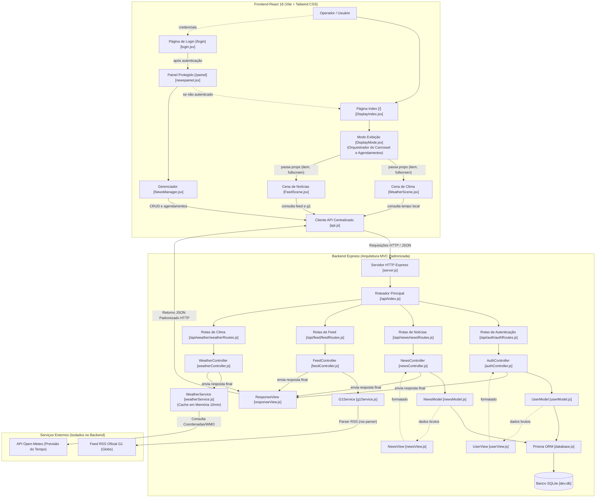
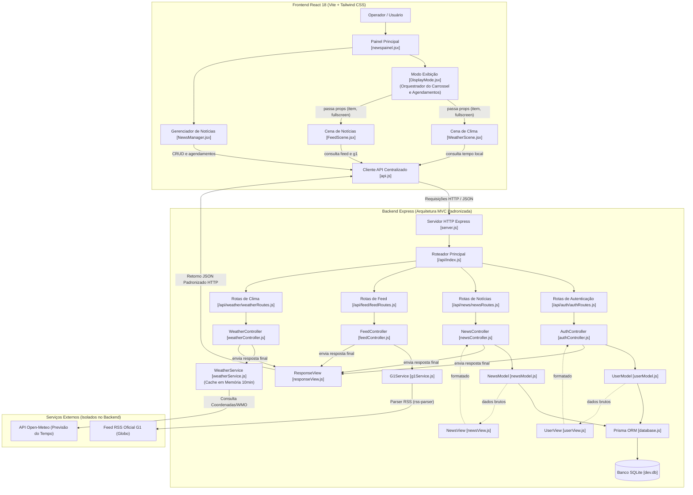

# Painel Digital de Notícias

Sistema Fullstack profissional para exibição, gerenciamento e agendamento de conteúdos em murais digitais, totens corporativos e Smart TVs. Desenvolvido com **React 18 (Vite) + Tailwind CSS** no Frontend e **Node.js (Express) + Prisma ORM (SQLite)** no Backend sob **Arquitetura MVC (Model-View-Controller)**.

---

## 🌟 Principais Funcionalidades

### 1. 📺 Modo de Exibição (Carrossel Inteligente para TVs)
- **Transição Suave e Elegante (`carouselFade`)**: Dissolvência com micro-escala e desfoque suave para troca de notícias sem cortes bruscos.
- **Efeito Respiratório em Fotos (`kenBurns`)**: Zoom lento contínuo em fotos para dar dinamismo cinematográfico às telas.
- **Modo Tela Cheia 100% Limpo**: Oculta todos os controles para exibição contínua em TVs e painéis de parede (com atalho `ESC` ou duplo clique para sair).
- **Conteúdo Centralizado**: Layout adaptativo com tipografia de alta legibilidade à distância.
- **Temporização Individualizada**: Cada notícia ou cena possui seu próprio tempo de permanência na tela (`slideDuration`).

### 2. ☀️ Cena de Clima & Previsão do Tempo (`WeatherScene`)
- **Temperatura em Tempo Real**: Dados meteorológicos locais com temperatura atual, sensação térmica, umidade relativa do ar e velocidade do vento.
- **Período do Dia Dinâmico**: Indicador com ícone e cor automática (Madrugada 🌙, Manhã 🌅, Tarde 🌇 e Noite 🌌).
- **Previsão dos Próximos 3 Dias**: Faixa com máximas e mínimas resumidas (Hoje, Amanhã, Depois).
- **Relógio e Data ao Vivo**: Horário com segundos e dia da semana em português.
- **Integração Open-Meteo**: Integração gratuita com fallback de contingência para operação offline.

### 3. 📡 Feed de Notícias em Tempo Real & RSS do G1 (`FeedScene`)
- **Integração com Feed RSS Oficial do G1 (Globo)**: Leitura em tempo real de `https://g1.globo.com/dynamo/rss2.xml` utilizando `rss-parser`.
- **Extração Automática de Imagens**: Parser inteligente que localiza a foto oficial da matéria veiculada pela Globo.
- **Profundidade Jornalística**: Exibe título, linha fina explicativa, corpo da reportagem e **caixa de pontos-chave** (tópicos essenciais).
- **News Ticker**: Barra inferior com giro das notícias do dia e botões de navegação rápida.
- **Categorias Temáticas**: G1 Brasil, Geral & Cidades, Tecnologia & IA, Economia & Negócios e Esportes.

### 4. 📅 Agendamento Antecipado de Conteúdos por Data e Horário
- **Início Programado (`publishAt`)**: Permite criar notícias que ficam ocultas e **entram no ar automaticamente** na data e hora marcadas, sem precisar recarregar o sistema.
- **Encerramento / Validade (`expiresAt`)**: Opção de permanência indefinida, duração rápida (15m, 1h, 24h, 7 dias) ou data/hora final de expiração.
- **Filtros no Gerenciador**: Abas para visualizar conteúdos **No Ar (🟢)**, **Agendados (🟡)** e **Expirados (🔴)** com contagem regressiva em tempo real.

### 5. 📱 Upload Direto da Galeria do Celular e Otimização
- Suporte a seleção de fotos diretamente do rolo de câmera do smartphone (`accept="image/*"`).
- **Compressão Automática via Canvas**: Redimensiona e otimiza imagens para JPEG leve (~150KB), garantindo carregamento instantâneo e economia de armazenamento no SQLite.

---

## 📖 Documentação Interativa Swagger (OpenAPI 3.0)

A API possui documentação interativa completa via Swagger UI:
- **Interface Swagger UI**: [http://localhost:5000/docs](http://localhost:5000/docs) (ou `/api-docs`)
- **Especificação OpenAPI JSON**: [http://localhost:5000/api/swagger.json](http://localhost:5000/api/swagger.json)
- **Arquivo de Configuração**: [`server/app/swagger/swagger-jsdoc.json`](file:///c:/Users/Computador/Documents/painelDeNoticia/server/app/swagger/swagger-jsdoc.json)

---

## 🏛️ Estrutura do Projeto

```
painelDeNoticia/
├── client/                     # FRONTEND (React 18 + Vite + Tailwind CSS)
│   ├── app/
│   │   ├── components/
│   │   │   ├── DisplayMode.jsx # Carrossel com transição suave, temporizador e tela cheia
│   │   │   ├── NewsManager.jsx # Formulário de criação, upload e agendamento
│   │   │   ├── WeatherScene.jsx# Cena de clima e previsão meteorológica
│   │   │   └── FeedScene.jsx   # Cena de telejornal com feed RSS ao vivo
│   │   ├── pages/
│   │   │   ├── DisplayIndex.jsx# PÁGINA INDEX (/) - Mural público / Modo TV contínuo
│   │   │   ├── login.jsx       # PÁGINA (/login) - Autenticação com credenciais
│   │   │   └── newspainel.jsx  # PÁGINA (/painel) - Gestão protegida (requer login)
│   │   ├── style/              # CSS base e keyframes de animação
│   │   └── main.jsx            # Configuração e proteção de rotas (React Router)
│   ├── lib/
│   │   ├── api.js              # Cliente de integração centralizado com a API (/api)
│   │   ├── g1Service.js        # Módulo de busca do feed RSS do G1
│   │   └── auth.js             # Funções de autenticação, sessão e proteção
│   └── package.json
│
├── server/                     # BACKEND MVC (Node.js + Express + Prisma ORM)
│   ├── app/
│   │   ├── model/              # [M] Regras de banco e persistência
│   │   │   ├── database.js     # Singleton Prisma Client
│   │   │   ├── newsModel.js    # Consultas e filtros (activeOnly, publishAt)
│   │   │   └── userModel.js    # Gestão de usuários
│   │   ├── view/               # [V] Formatação DTO e respostas JSON
│   │   │   ├── responseView.js # Padronização de respostas finais da API
│   │   │   ├── newsView.js     # Formatação de notícias e status (isLive, isScheduled)
│   │   │   └── userView.js     # Sanitização de dados de usuários
│   │   ├── controller/         # [C] Lógica de negócio
│   │   │   ├── newsController.js   # Criação, listagem e remoção de notícias
│   │   │   ├── weatherController.js# Controlador de previsão do tempo
│   │   │   ├── feedController.js   # Feed geral e integração G1
│   │   │   └── authController.js   # Login e registro
│   │   ├── service/            # Regras de negócio e integrações externas
│   │   │   ├── weatherService.js # Serviço Open-Meteo com cache em memória (10min)
│   │   │   └── g1Service.js    # Parser RSS oficial do G1 (rss-parser)
│   │   ├── routes/             # Rotas desacopladas Express (/api)
│   │   └── swagger/            # Especificação OpenAPI 3.0.3
│   ├── prisma/
│   │   ├── schema.prisma       # Modelos Prisma ORM (User, News)
│   │   └── dev.db              # Banco de dados local SQLite
│   ├── server.js               # Inicialização do Express e middlewares
│   └── package.json
│
├── .gitignore                  # Regras de exclusão (ignora dev.db, node_modules)
└── README.md
```


---

## 🧭 Navegação e Fluxo de Telas no Frontend

1. **Página Inicial / Index (`/`)**:
   - É a tela principal de **Modo Exibição (`DisplayIndex.jsx` + `DisplayMode.jsx`)**, ideal para Smart TVs, painéis e totens públicos.
   - Apresenta o carrossel contínuo de notícias, cenas de clima e feeds com suporte a tela cheia 100% limpa.
   - Possui botão discreto de **"Acesso Restrito / Entrar"** que direciona para a tela de login.
2. **Autenticação (`/login`)**:
   - Permite que operadores e administradores insiram login/e-mail e senha.
   - Ao autenticar com sucesso, salva a sessão e redireciona para o painel de gerenciamento (`/painel`).
   - Se o usuário desistir ou cancelar, pode clicar em **"Voltar para o Modo Exibição"** para retornar ao Index (`/`).
3. **Gerenciador de Notícias (`/painel`)**:
   - **Rota Protegida**: Caso um usuário tente acessar `/painel` sem estar autenticado, o sistema o **redireciona automaticamente para a página de index (`/`)**.
   - Permite criar, agendar e excluir notícias e cenas, visualizar contagens regressivas e acionar o botão de logout ("Sair") para encerrar a sessão.

---

## 📐 Arquitetura do Sistema e Fluxo de Dados

A arquitetura do projeto segue o padrão **MVC (Model-View-Controller)** no backend e **Componentes Desacoplados (Container/Presentation)** no frontend:



### 🎯 Resolução dos Três Pontos Arquiteturais

#### 1. Fluxo do Backend e Eliminação do Gargalo de "Resposta JSON"
- **Fluxo Corrigido e Padronizado**: As requisições HTTP chegam nas **Rotas Express** $\rightarrow$ são despachadas diretamente para os respectivos **Controllers** $\rightarrow$ os Controllers acionam os **Models/Services** $\rightarrow$ utilizam as **Views/Formatters** (`newsView`, `userView`) $\rightarrow$ e, **somente no encerramento**, o Controller chama o `responseView.js` para enviar o JSON de resposta ao cliente. O `responseView.js` atua estritamente como formatador final, nunca como barreira intermediária entre rotas e regras de negócio.
- **NewsController Padronizado**: O módulo de notícias possui rota desacoplada `newsRoutes.js` apontando estritamente para `NewsController.js` (`getAll`, `create`, `remove`), que gerencia o acesso ao `newsModel.js` e Prisma Client.

#### 2. Desacoplamento no Frontend (Modo Exibição vs Cenas Especializadas)
- **Modo Exibição como Orquestrador (`DisplayMode.jsx`)**: É responsável pelo ciclo de vida da tela: temporização individualizada de cada slide (`slideDuration`), barra de progresso, alternância em tela cheia (Fullscreen API), transição suave com `animate-carousel-fade` e filtragem em tempo real de agendamentos (`publishAt` e `expiresAt`). Ele **passa props** (`item`, `isFullscreen`) para as cenas filhas.
- **Cenas Independentes com API Centralizada**: `WeatherScene.jsx` e `FeedScene.jsx` são componentes especializados que recebem suas configurações via props e executam suas buscas/atualizações periódicas de forma independente através do cliente centralizado `api.js`, evitando duplicidade de requisições no componente pai.

#### 3. Intermediação e Caching de Serviços Externos (RSS e Open-Meteo)
- **Centralização Exclusiva no Backend**: O Frontend **nunca** realiza requisições diretas a serviços de terceiros como Open-Meteo ou feeds externos. Todas as requisições passam pela API local (`/api/weather` e `/api/feed/g1`).
- **Camada de Serviços Dedicada com Cache**:
  - `weatherService.js`: Gerencia a integração com a Open-Meteo, tradução de códigos meteorológicos WMO, coordenadas geográficas e conta com **Cache em Memória de 10 minutos**. Requisições repetidas de múltiplos painéis são atendidas instantaneamente sem onerar o serviço externo.
  - `g1Service.js`: Realiza o parse seguro do RSS do G1 via `rss-parser`, extração de fotos da CDN da Globo e higienização de textos no servidor, contornando limitações de CORS do navegador.
- **Resiliência Offline (Fallback Gracioso)**: Caso a conexão com a internet oscile, tanto o serviço de clima quanto o de notícias fornecem dados de contingência estruturados, garantindo que Smart TVs e totens nunca fiquem com a tela em branco.

---

## 📐 Arquitetura do Sistema e Fluxo de Dados

A arquitetura foi desenhada seguindo as melhores práticas do padrão **MVC (Model-View-Controller)** no backend e **Componentes Desacoplados (Container/Presentation)** no frontend:



### 🎯 Resolução dos Três Pontos Arquiteturais

#### 1. Fluxo do Backend e Eliminação do Gargalo de "Resposta JSON"
- **Fluxo Corrigido e Padronizado**: As requisições HTTP chegam nas **Rotas Express** $\rightarrow$ são despachadas diretamente para os respectivos **Controllers** $\rightarrow$ os Controllers acionam os **Models/Services** $\rightarrow$ utilizam as **Views/Formatters** (`newsView`, `userView`) $\rightarrow$ e, **somente no encerramento**, o Controller chama o `responseView.js` para enviar o JSON de resposta ao cliente.
- **NewsController Padronizado**: O módulo de notícias possui rota desacoplada `newsRoutes.js` apontando estritamente para `NewsController.js` (`getAll`, `create`, `remove`), que gerencia o acesso ao `newsModel.js` e Prisma Client. O `responseView.js` não atua como middleware ou barreira intermediária.

#### 2. Desacoplamento no Frontend (Modo Exibição vs Cenas Especializadas)
- **Modo Exibição como Orquestrador (`DisplayMode.jsx`)**: É responsável pelo ciclo de vida da tela: temporização individualizada de cada slide (`slideDuration`), barra de progresso, alternância em tela cheia (Fullscreen API), transição com `animate-carousel-fade` e filtragem em tempo real de agendamentos (`publishAt` e `expiresAt`). Ele **passa props** (`item`, `isFullscreen`) para as cenas filhas.
- **Cenas Independentes com API Centralizada**: `WeatherScene.jsx` e `FeedScene.jsx` são componentes especializados que recebem suas configurações via props e executam suas buscas/atualizações periódicas de forma independente através do cliente centralizado `api.js`, evitando duplicidade de requisições no componente pai.

#### 3. Intermediação e Caching de Serviços Externos (RSS e Open-Meteo)
- **Centralização Exclusiva no Backend**: O Frontend **nunca** realiza requisições diretas a serviços de terceiros como Open-Meteo ou feeds externos. Todas as requisições passam pela API local (`/api/weather` e `/api/feed/g1`).
- **Camada de Serviços Dedicada com Cache**:
  - `weatherService.js`: Gerencia a integração com a Open-Meteo, tradução de códigos meteorológicos WMO, coordenadas geográficas e conta com **Cache em Memória de 10 minutos**. Requisições repetidas de múltiplos painéis são atendidas instantaneamente sem onerar o serviço externo.
  - `g1Service.js`: Realiza o parse seguro do RSS do G1 via `rss-parser`, extração de fotos da CDN da Globo e higienização de textos no servidor, contornando limitações de CORS do navegador.
- **Resiliência Offline (Fallback Gracioso)**: Caso a conexão com a internet oscile, tanto o serviço de clima quanto o de notícias fornecem dados de contingência estruturados, garantindo que Smart TVs e totens nunca fiquem com a tela em branco.

---

## 🧭 Navegação e Fluxo de Telas no Frontend

1. **Página Inicial / Index (`/`)**:
   - É a tela principal de **Modo Exibição (`DisplayIndex.jsx` + `DisplayMode.jsx`)**, ideal para Smart TVs, painéis e totens públicos.
   - Apresenta o carrossel contínuo de notícias, cenas de clima e feeds com suporte a tela cheia 100% limpa.
   - Possui botão discreto de **"Acesso Restrito / Entrar"** que direciona para a tela de login.
2. **Autenticação (`/login`)**:
   - Permite que operadores e administradores insiram login/e-mail e senha.
   - Ao autenticar com sucesso, salva a sessão e redireciona para o painel de gerenciamento (`/painel`).
   - Se o usuário desistir ou cancelar, pode clicar em **"Voltar para o Modo Exibição"** para retornar ao Index (`/`).
3. **Gerenciador de Notícias (`/painel`)**:
   - **Rota Protegida**: Caso um usuário tente acessar `/painel` sem estar autenticado, o sistema o **redireciona automaticamente para a página de index (`/`)**.
   - Permite criar, agendar e excluir notícias e cenas, visualizar contagens regressivas e acionar o botão de logout ("Sair") para encerrar a sessão.

---

## 📐 Arquitetura do Sistema e Fluxo de Dados

A arquitetura do projeto segue o padrão **MVC (Model-View-Controller)** no backend e **Componentes Desacoplados (Container/Presentation)** no frontend:


### 🎯 Resolução dos Três Pontos Arquiteturais

#### 1. Fluxo do Backend e Eliminação do Gargalo de "Resposta JSON"
- **Fluxo Corrigido e Padronizado**: As requisições HTTP chegam nas **Rotas Express** $\rightarrow$ são despachadas diretamente para os respectivos **Controllers** $\rightarrow$ os Controllers acionam os **Models/Services** $\rightarrow$ utilizam as **Views/Formatters** (`newsView`, `userView`) $\rightarrow$ e, **somente no encerramento**, o Controller chama o `responseView.js` para enviar o JSON de resposta ao cliente. O `responseView.js` atua estritamente como formatador final, nunca como barreira intermediária entre rotas e regras de negócio.
- **NewsController Padronizado**: O módulo de notícias possui rota desacoplada `newsRoutes.js` apontando estritamente para `NewsController.js` (`getAll`, `create`, `remove`), que gerencia o acesso ao `newsModel.js` e Prisma Client.

#### 2. Desacoplamento no Frontend (Modo Exibição vs Cenas Especializadas)
- **Modo Exibição como Orquestrador (`DisplayMode.jsx`)**: É responsável pelo ciclo de vida da tela: temporização individualizada de cada slide (`slideDuration`), barra de progresso, alternância em tela cheia (Fullscreen API), transição suave com `animate-carousel-fade` e filtragem em tempo real de agendamentos (`publishAt` e `expiresAt`). Ele **passa props** (`item`, `isFullscreen`) para as cenas filhas.
- **Cenas Independentes com API Centralizada**: `WeatherScene.jsx` e `FeedScene.jsx` são componentes especializados que recebem suas configurações via props e executam suas buscas/atualizações periódicas de forma independente através do cliente centralizado `api.js`, evitando duplicidade de requisições no componente pai.

#### 3. Intermediação e Caching de Serviços Externos (RSS e Open-Meteo)
- **Centralização Exclusiva no Backend**: O Frontend **nunca** realiza requisições diretas a serviços de terceiros como Open-Meteo ou feeds externos. Todas as requisições passam pela API local (`/api/weather` e `/api/feed/g1`).
- **Camada de Serviços Dedicada com Cache**:
  - `weatherService.js`: Gerencia a integração com a Open-Meteo, tradução de códigos meteorológicos WMO, coordenadas geográficas e conta com **Cache em Memória de 10 minutos**. Requisições repetidas de múltiplos painéis são atendidas instantaneamente sem onerar o serviço externo.
  - `g1Service.js`: Realiza o parse seguro do RSS do G1 via `rss-parser`, extração de fotos da CDN da Globo e higienização de textos no servidor, contornando limitações de CORS do navegador.
- **Resiliência Offline (Fallback Gracioso)**: Caso a conexão com a internet oscile, tanto o serviço de clima quanto o de notícias fornecem dados de contingência estruturados, garantindo que Smart TVs e totens nunca fiquem com a tela em branco.

---

## 📡 Endpoints da API

### 📰 Notícias e Cenas (`/api/news`)
| Método | Endpoint | Descrição |
|---|---|---|
| `GET` | `/api/news` | Lista notícias (suporta `?active=true` e `?category=X`) |
| `POST` | `/api/news` | Cria notícia ou cena com agendamento antecipado (**CREATE**) |
| `DELETE` | `/api/news/:id` | Remove uma notícia do banco SQLite (**DELETE**) |
| `POST` | `/api/news/seed/demo` | Popula o banco com notícias de demonstração caso vazio |

### ☀️ Clima & Tempo (`/api/weather`)
| Método | Endpoint | Descrição |
|---|---|---|
| `GET` | `/api/weather?city=SaoPaulo` | Previsão ao vivo (temperatura, umidade, vento, extremos e 3 dias) |
| `GET` | `/api/weather/cities` | Lista de capitais brasileiras pré-configuradas |

### 📡 Feed & RSS ao Vivo (`/api/feed`)
| Método | Endpoint | Descrição |
|---|---|---|
| `GET` | `/api/feed/general?category=geral` | Feed jornalístico categorizado com fotos e matérias completas |
| `GET` | `/api/feed/g1` | Feed RSS oficial do G1 em tempo real com imagem da reportagem |
| `GET` | `/api/feed/categories` | Lista de editorias disponíveis para configuração |

### 🔐 Autenticação & Usuários (`/api/auth`)
| Método | Endpoint | Descrição |
|---|---|---|
| `POST` | `/api/auth/login` | Login com identificador e senha |
| `POST` | `/api/auth/register` | Cadastro de usuário administrador |
| `GET` | `/api/auth/users` | Listagem de usuários cadastrados |

### ⚙️ Status da API
| Método | Endpoint | Descrição |
|---|---|---|
| `GET` | `/api/status` | Retorna status de execução e catálogo de rotas ativas |

---


## 🚀 Como Executar o Projeto

### Pré-requisitos
- **Node.js** (v18 ou superior)
- **npm** (incluso no Node.js)

### 1. Iniciar o Servidor Backend (API MVC + Swagger UI)
```powershell
npm run dev:server
```
> O servidor iniciará em `http://localhost:5000`. Acesse a documentação Swagger em `http://localhost:5000/docs`.

### 2. Iniciar o Frontend (React + Vite)
```powershell
npm run dev:client
```
> O painel iniciará em `http://localhost:3000`.

### 3. Compilar o Frontend para Produção
```powershell
npm run build:client
```

### 4. Abrir o Prisma Studio (Gerenciador Visual do Banco SQLite)
```powershell
npm run prisma:studio
```

---

## 📋 Licença
Projeto desenvolvido para fins institucionais e exibição de notícias digitais.
